<div align="center">

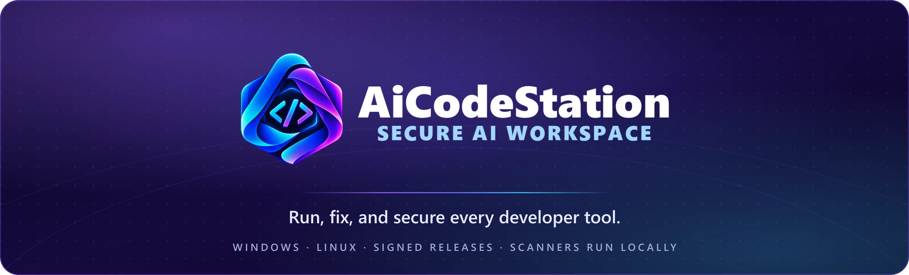

<br>

[](https://aicodestation.com/downloads/)
[](https://aicodestation.com/downloads/)
[](https://aicodestation.com/downloads/)
[](https://aicodestation.com/downloads/)
[](#verify-what-you-downloaded)

<br>

<a href="https://app.aicodestation.com/"><b>Product page</b></a> &nbsp;•&nbsp;
<a href="https://aicodestation.com/downloads/"><b>Download</b></a> &nbsp;•&nbsp;
<a href="https://aicodestation.com/features/"><b>Features</b></a> &nbsp;•&nbsp;
<a href="https://aicodestation.com/docs/"><b>Docs</b></a> &nbsp;•&nbsp;
<a href="https://aicodestation.com/security/"><b>Trust Center</b></a> &nbsp;•&nbsp;
<a href="https://aicodestation.com/pricing/"><b>Pricing</b></a> &nbsp;•&nbsp;
<a href="https://aicodestation.com"><b>Website</b></a>

</div>

<br>

<div align="center">

### Your whole toolbox in one window, with a security gate in front of it

Every tool you own becomes a card you can run, inspect, scan, and share.<br>
Every run passes a pre-execution check before a single command touches your system.

**It is not a cloud IDE.** The app runs locally, the scanners run locally, and you choose the AI provider.


</div>

<br>

## Why it exists

<table>
<tr>
<td width="33%" valign="top">

### Nothing runs unchecked

A command blacklist, input sanitization, role gates, zero-trust egress, and source-read
authorization all run **before** execution, not after the damage.

</td>
<td width="33%" valign="top">

### Your code stays yours

Bundled scanners run on your machine. Secure code review sends only scrubbed changed
lines to the AI, and only if you let it.

</td>
<td width="33%" valign="top">

### Built to be audited

An append-only, tamper-evident audit chain with SIEM export. Signed releases. Secrets
held by your OS keyring or your own vault.

</td>
</tr>
</table>

<br>

## Inside the workspace

<table>
<tr>
<td width="50%" valign="top">
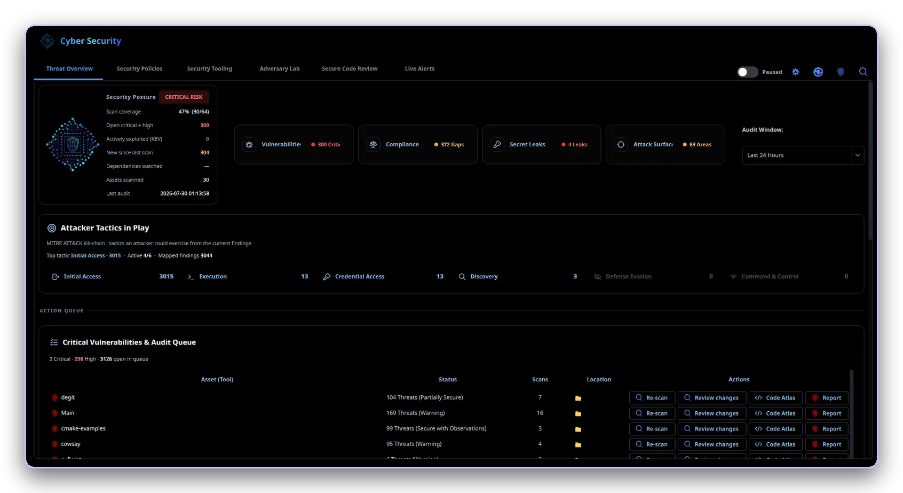
<br><br>

**Threat overview**

Posture, scan coverage, and open findings, mapped to the MITRE ATT&CK tactics an attacker
could actually exercise from them.

</td>
<td width="50%" valign="top">

<br><br>

**Security tooling**

SAST, SCA, SBOM, secret detection, IaC and container config, YARA and IOC matching, license
compliance, and AI/ML model security, in one panel.

</td>
</tr>
<tr>
<td width="50%" valign="top">
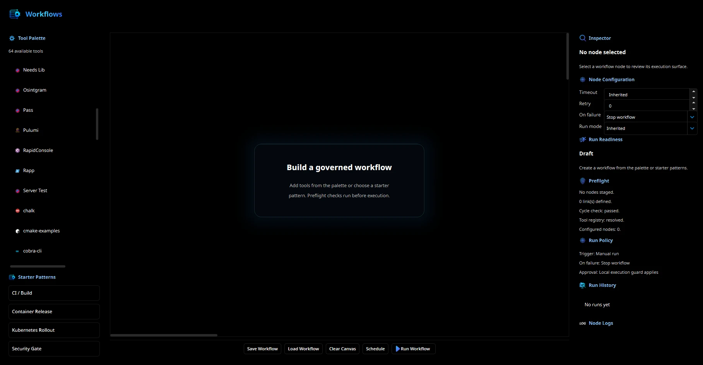
<br><br>

**Governed workflows**

Chain tools from the palette or a starter pattern. Preflight checks, retry and failure
policy, approval gates, and a full run log.

</td>
<td width="50%" valign="top">
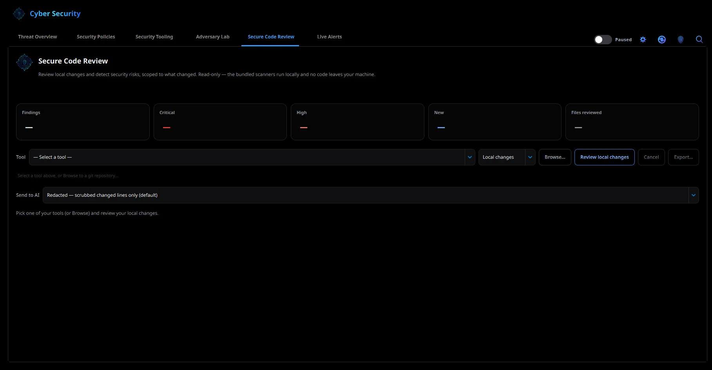
<br><br>

**Secure code review**

Scoped to what changed. Read-only, scanners run locally, and what reaches the AI is
redacted by default.

</td>
</tr>
<tr>
<td width="50%" valign="top">

<br><br>

**Hardened by default**

Passkeys through Windows Hello or a security key, encrypted anti-rollback backup, and an
execution control policy you set once.

</td>
<td width="50%" valign="top">
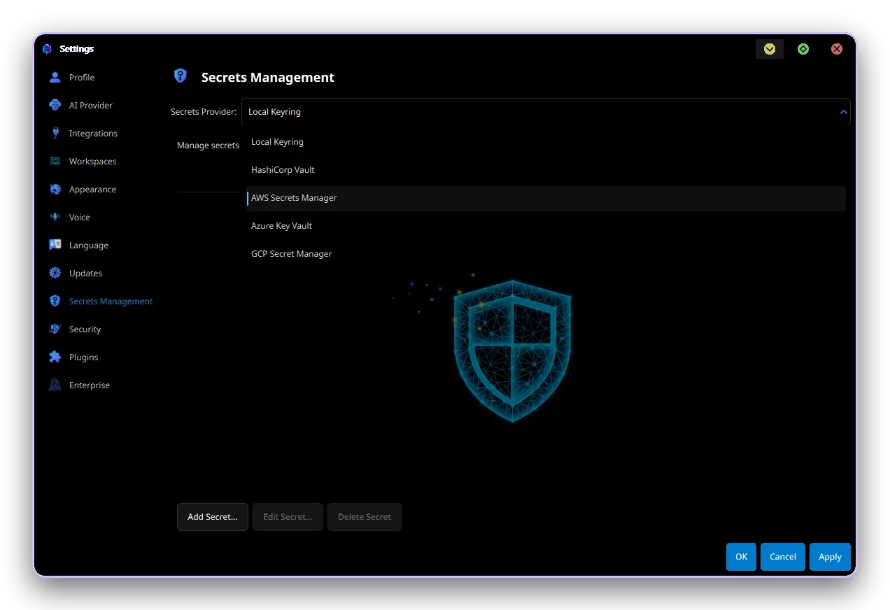
<br><br>

**Secrets stay outside the app**

Local OS keyring by default, or HashiCorp Vault, AWS Secrets Manager, Azure Key Vault, or
GCP Secret Manager.

</td>
</tr>
<tr>
<td width="50%" valign="top">
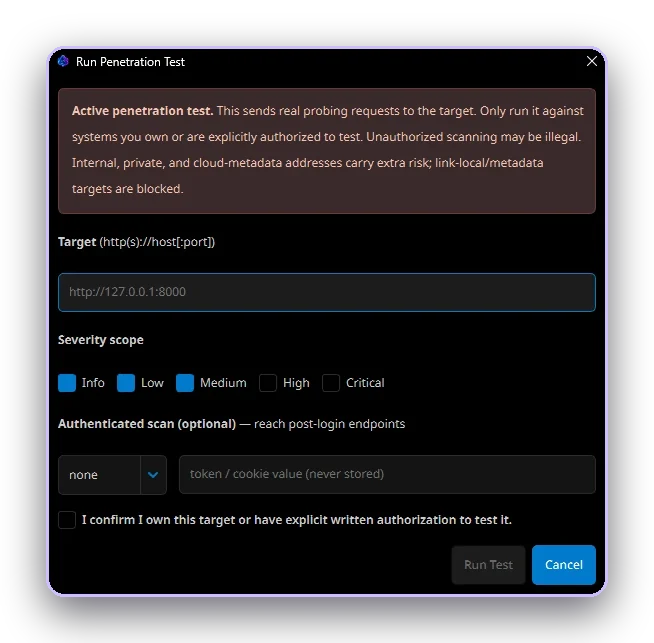
<br><br>

**Nothing probes without permission**

Active tests demand an explicit ownership confirmation. Link-local and cloud-metadata targets
are blocked outright, and severity scope is yours to set.

</td>
<td width="50%" valign="top">
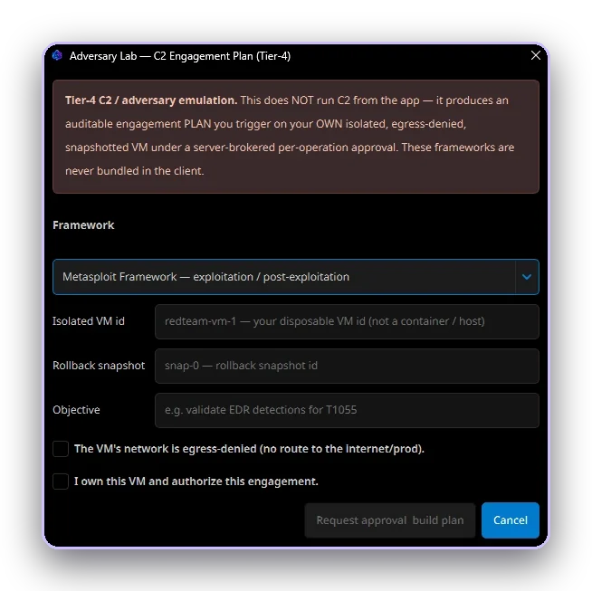
<br><br>

**Adversary lab, without the payload**

Produces an auditable engagement plan for your own isolated, egress-denied VM under a
server-brokered approval. The frameworks are never bundled in the client.

</td>
</tr>
<tr>
<td width="50%" valign="top">
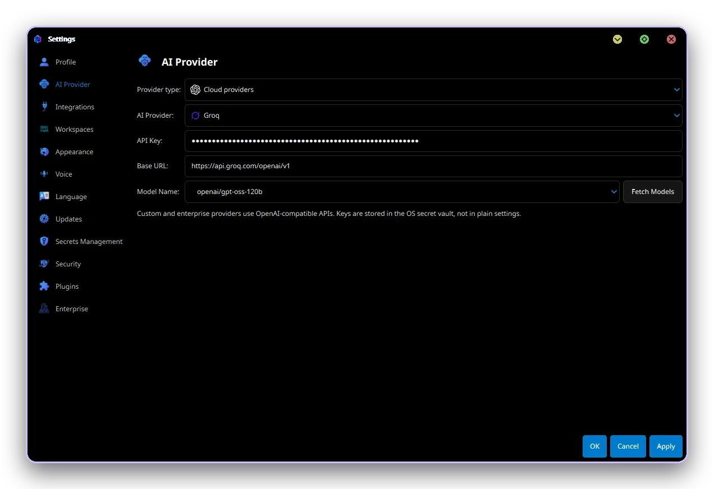
<br><br>

**Bring your own model**

Any OpenAI-compatible provider, cloud or local. Keys live in the OS secret vault, never in
plain settings.

</td>
<td width="50%" valign="top">
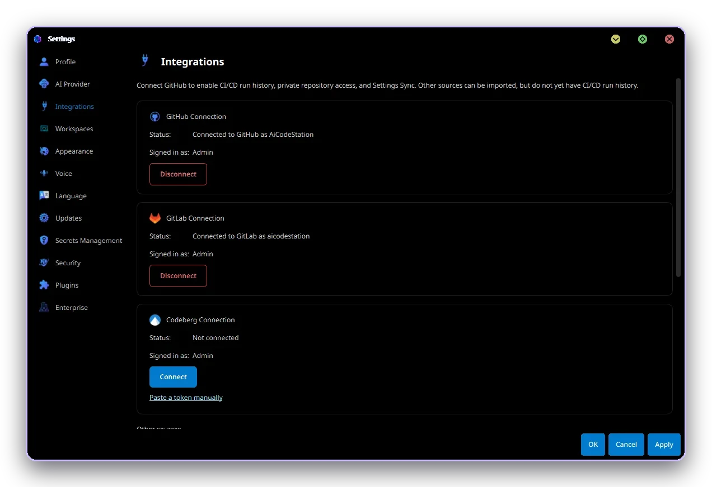
<br><br>

**Your own remotes**

GitHub, GitLab, and Codeberg connections, with CI/CD run history and private repository
access once connected.

</td>
</tr>
<tr>
<td width="50%" valign="top">
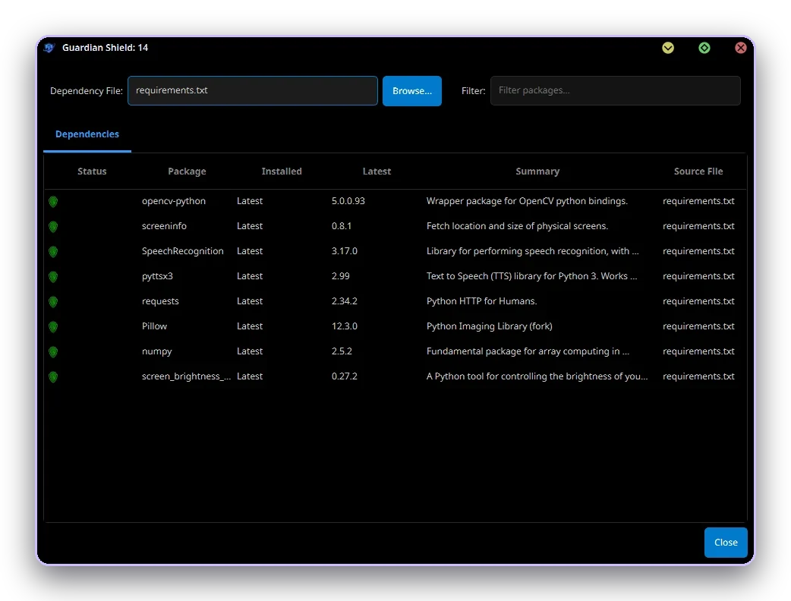
<br><br>

**Dependency watch**

Installed against latest, per source file, for every tool in your workspace.

</td>
<td width="50%" valign="top">
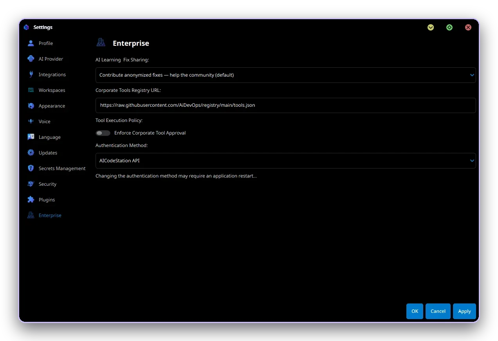
<br><br>

**Enterprise controls**

A corporate tools registry, enforced tool approval, and the authentication method your
organisation already uses.

</td>
</tr>
</table>

<div align="center">

**[See all of this on the full product page →](https://app.aicodestation.com/)**

</div>

<div align="center">
<br>
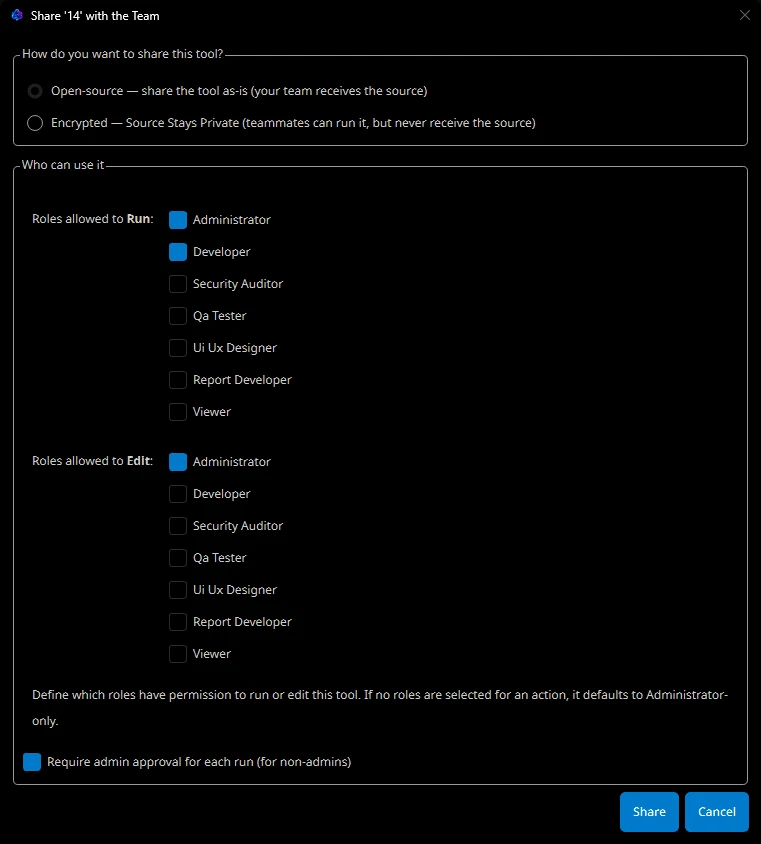

**Sealed sharing.** Share a tool as source, or encrypted so teammates can run it and never
receive the source. Run and edit permissions are set per role.

</div>

<br>

## Install

<table>
<tr><th align="left">Platform</th><th align="left">File</th><th align="left">SHA-256</th></tr>
<tr>
<td><b>Windows</b><br><sub>10 / 11, 64-bit</sub></td>
<td><a href="https://acsdownloads.blob.core.windows.net/releases/1.0.30/AiCodeStation-Setup-1.0.30.exe"><code>AiCodeStation-Setup-1.0.30.exe</code></a></td>
<td><sub><code>e795b70ae550d585c6b95eacb4a6bfdb0c87bf7c571dbe076eb20655f0c42e70</code></sub></td>
</tr>
<tr>
<td><b>Debian</b><br><sub>Ubuntu, Mint</sub></td>
<td><a href="https://acsdownloads.blob.core.windows.net/releases/1.0.30/aicodestation_1.0.30_amd64.deb"><code>aicodestation_1.0.30_amd64.deb</code></a></td>
<td><sub><code>a05f7ee5dcd06455c2c141d15bd08b92eaac68655fa6fc8e8433d15074f33371</code></sub></td>
</tr>
<tr>
<td><b>RPM</b><br><sub>Fedora, RHEL, openSUSE</sub></td>
<td><a href="https://acsdownloads.blob.core.windows.net/releases/1.0.30/aicodestation-1.0.30-1.x86_64.rpm"><code>aicodestation-1.0.30-1.x86_64.rpm</code></a></td>
<td><sub><code>bf633f769b67331f952f5b84a6285a6335c34d5eb0c77d34408363dddf35d3bf</code></sub></td>
</tr>
<tr>
<td><b>AppImage</b><br><sub>any modern Linux</sub></td>
<td><a href="https://acsdownloads.blob.core.windows.net/releases/1.0.30/AiCodeStation-1.0.30-x86_64.AppImage"><code>AiCodeStation-1.0.30-x86_64.AppImage</code></a></td>
<td><sub><code>4430203b37e8120ec0cdb3d92e5da5f4bff1c8ce156a6d7bc7adbd250e0f8fbd</code></sub></td>
</tr>
<tr>
<td><b>Archive</b><br><sub>portable</sub></td>
<td><a href="https://acsdownloads.blob.core.windows.net/releases/1.0.30/AiCodeStation-1.0.30-linux-x86_64.tar.gz"><code>AiCodeStation-1.0.30-linux-x86_64.tar.gz</code></a></td>
<td><sub><code>bb48690618b6e54a18e0c61829c51ce757c8ce0fc569ccd114c943194f4bd9ba</code></sub></td>
</tr>
<tr>
<td><b>macOS</b><br><sub>Apple Silicon and Intel</sub></td>
<td colspan="2"><sub>Coming soon</sub></td>
</tr>
</table>

### Install from the repository, Debian and Ubuntu

The package manager then checks the signature on **every** update, not only the first time.

```bash
curl -fsSL https://acsdownloads.blob.core.windows.net/releases/aicodestation-release-key.asc \
  | sudo gpg --dearmor -o /usr/share/keyrings/aicodestation.gpg

echo "deb [arch=amd64 signed-by=/usr/share/keyrings/aicodestation.gpg] https://acsdownloads.blob.core.windows.net/releases stable main" \
  | sudo tee /etc/apt/sources.list.d/aicodestation.list

sudo apt update && sudo apt install aicodestation
```

Fedora, RHEL, and openSUSE repository setup is on the [downloads page](https://aicodestation.com/downloads/).

### Verify what you downloaded

A checksum proves the file did not arrive corrupted. It cannot prove the page it came from
was not changed. So every release file is also GPG signed, and the signing key lives on
neither the website server nor the download server.

```
Release key fingerprint

E779 76A5 D8A6 1752 8244  D939 E4E6 5E94 12CD 53CA
```

```bash
gpg --import aicodestation-release-key.asc
gpg --fingerprint
gpg --verify aicodestation_1.0.30_amd64.deb.asc aicodestation_1.0.30_amd64.deb
```

Compare the fingerprint gpg prints against the one above before trusting anything else. gpg
will also warn that the key is not certified by a trusted signature. That is expected and is
not a failure. It only means you have not personally vouched for the key.

A signature sits beside every download, along with a signed `SHA256SUMS.txt.asc`.

<br>

## Security model

| | |
|:--|:--|
| **Pre-execution gate** | Command blacklist, input sanitization, role and corporate gates, zero-trust egress, source-read authorization. |
| **Local by default** | Bundled scanners run on your machine. Secure code review sends scrubbed changed lines only. |
| **Signed end to end** | Releases and updates are signed, and the update path checks that signature. |
| **Tamper-evident audit** | Append-only audit chain with SIEM export. |
| **Secrets outside the app** | OS keyring, or your existing external secret manager. |
| **Sealed sharing** | Share a tool run-only, so a teammate executes it without receiving the source. |

Full detail is in the [Trust Center](https://aicodestation.com/security/).
Found a vulnerability? See [SECURITY.md](SECURITY.md). Responsible disclosure is welcome.

<br>

## Plans

| Plan | For |
|:--|:--|
| **Free** | The workspace, signed builds, and the core tooling. |
| **Pro** | Individual developers who want the full engine. Free for verified students with a `.edu` address. |
| **Enterprise** | Dual control, JIT elevation, SIEM export, corporate gates, and support. Contact us for pricing. |

The full side-by-side comparison is on the [pricing page](https://aicodestation.com/pricing/).

<br>

## Support

| | |
|:--|:--|
| Documentation | [aicodestation.com/docs](https://aicodestation.com/docs/) |
| Bugs and feature requests | [Open an issue](../../issues) |
| Security disclosure | [SECURITY.md](SECURITY.md) |
| Anything else | [aicodestation.com/contact](https://aicodestation.com/contact/) |

<br>

---

<div align="center">

<sub>

This repository is the public home of the AiCodeStation desktop application: release
information, verification instructions, documentation, and issue tracking.<br>
AiCodeStation is a commercial product and its source code is not distributed here.

**© AiCodeStation LLC, California**
&nbsp;·&nbsp; <a href="https://aicodestation.com/terms/">Terms</a>
&nbsp;·&nbsp; <a href="https://aicodestation.com/privacy/">Privacy</a>
&nbsp;·&nbsp; <a href="https://aicodestation.com/refund/">Refunds</a>

</sub>

</div>
