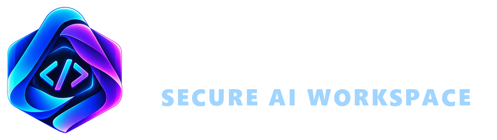
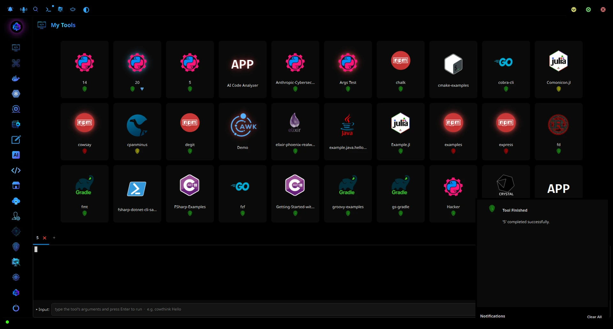
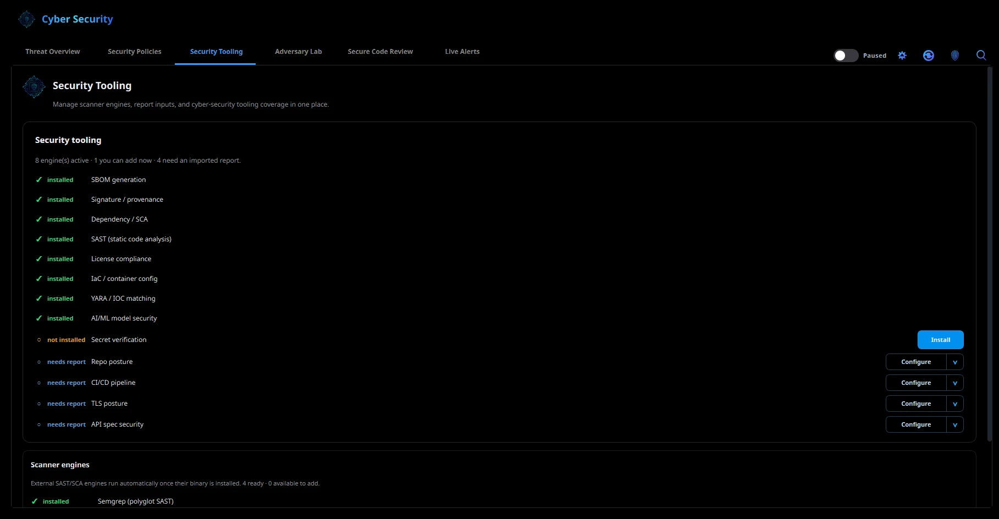
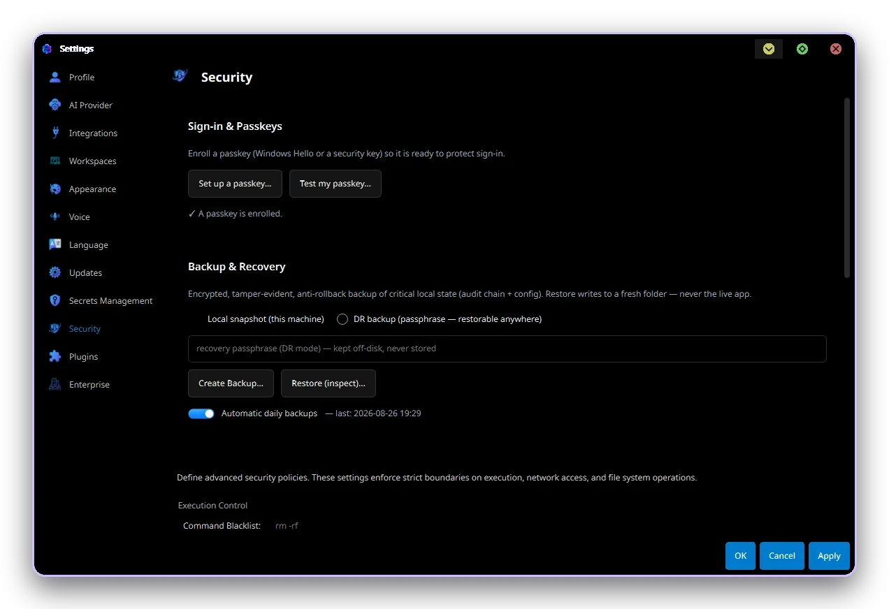

<div align="center">



### Secure AI Coding Workspace

**Run, fix, and secure every developer tool.**

A desktop AI command station for controlled software-building workflows.
Build, run, scan, and review code from one governed workspace, on your own machine.

[](https://aicodestation.com/downloads/)
[](https://aicodestation.com/downloads/)
[](https://aicodestation.com/downloads/)
[](https://aicodestation.com/downloads/)
[](#verify-what-you-downloaded)
[](LICENSE)

[**Website**](https://aicodestation.com) &nbsp;·&nbsp;
[**Features**](https://aicodestation.com/features/) &nbsp;·&nbsp;
[**Docs**](https://aicodestation.com/docs/) &nbsp;·&nbsp;
[**Security**](https://aicodestation.com/security/) &nbsp;·&nbsp;
[**Download**](https://aicodestation.com/downloads/) &nbsp;·&nbsp;
[**Pricing**](https://aicodestation.com/pricing/)

</div>

<div align="center">
  
</div>

---

## What it is

AiCodeStation is a desktop application that puts your whole developer toolbox in one place and puts
a security gate in front of it. Every tool you own becomes a card you can run, inspect, scan, and
share, and every run passes a pre-execution check before a single command touches your system.

It is not a cloud IDE. The app runs locally, the scanners run locally, and you choose which AI
provider it talks to.

| | |
|---|---|
| **One workspace for every tool** | Import your scripts, CLIs, and repos. Run them from a single grid with arguments, live output, and run history. |
| **Security on every run** | A command blacklist, input sanitization, role gates, and zero-trust egress checks run before execution, not after. |
| **A real security engine** | SAST, SCA, SBOM, secret detection, IaC and container config, YARA and IOC matching, license compliance, AI/ML model security. |
| **Governed workflows** | Chain tools into a workflow with preflight checks, retry and failure policy, approval gates, and a full run log. |
| **Bring your own everything** | Any AI provider, your own Git remotes, permission-scoped plugins, reproducible Docker environments. |
| **Enterprise controls** | Passkeys, dual control, JIT privilege elevation, tamper-evident audit with SIEM export, OS secret vault, external secret managers. |
| **Voice control** | Drive the workspace by voice, offline and private. |

---

## Inside the workspace

<table>
<tr>
<td width="50%"><br><sub><b>Threat overview.</b> Posture, scan coverage, open findings, and the attacker tactics those findings map to.</sub></td>
<td width="50%"><br><sub><b>Security tooling.</b> Every scanner engine in one place, with what is installed and what still needs a report.</sub></td>
</tr>
<tr>
<td width="50%"><br><sub><b>Workflows.</b> Build a chain from the tool palette or a starter pattern. Preflight runs before execution.</sub></td>
<td width="50%"><br><sub><b>Secure code review.</b> Scoped to what changed, scanners run locally, and what reaches the AI is redacted by default.</sub></td>
</tr>
<tr>
<td width="50%"><br><sub><b>Security settings.</b> Passkeys, encrypted anti-rollback backup, and execution control policy.</sub></td>
<td width="50%"><br><sub><b>Secrets.</b> Local keyring, HashiCorp Vault, AWS Secrets Manager, Azure Key Vault, or GCP Secret Manager.</sub></td>
</tr>
</table>

<div align="center">
  <br>
  <sub><b>Sealed sharing.</b> Share a tool as source, or encrypted so teammates can run it but never receive the source. Permissions are set per role.</sub>
</div>

More screenshots and the full capability list are on the [features page](https://aicodestation.com/features/).

---

## Download

Current release: **1.0.30**

| Platform | File | SHA-256 |
|---|---|---|
| Windows 10 / 11, 64-bit | [`AiCodeStation-Setup-1.0.30.exe`](https://acsdownloads.blob.core.windows.net/releases/1.0.30/AiCodeStation-Setup-1.0.30.exe) | `e795b70ae550d585c6b95eacb4a6bfdb0c87bf7c571dbe076eb20655f0c42e70` |
| Debian, Ubuntu, Mint | [`aicodestation_1.0.30_amd64.deb`](https://acsdownloads.blob.core.windows.net/releases/1.0.30/aicodestation_1.0.30_amd64.deb) | `a05f7ee5dcd06455c2c141d15bd08b92eaac68655fa6fc8e8433d15074f33371` |
| Fedora, RHEL, openSUSE | [`aicodestation-1.0.30-1.x86_64.rpm`](https://acsdownloads.blob.core.windows.net/releases/1.0.30/aicodestation-1.0.30-1.x86_64.rpm) | `bf633f769b67331f952f5b84a6285a6335c34d5eb0c77d34408363dddf35d3bf` |
| Any modern Linux | [`AiCodeStation-1.0.30-x86_64.AppImage`](https://acsdownloads.blob.core.windows.net/releases/1.0.30/AiCodeStation-1.0.30-x86_64.AppImage) | `4430203b37e8120ec0cdb3d92e5da5f4bff1c8ce156a6d7bc7adbd250e0f8fbd` |
| Linux, portable archive | [`AiCodeStation-1.0.30-linux-x86_64.tar.gz`](https://acsdownloads.blob.core.windows.net/releases/1.0.30/AiCodeStation-1.0.30-linux-x86_64.tar.gz) | `bb48690618b6e54a18e0c61829c51ce757c8ce0fc569ccd114c943194f4bd9ba` |
| macOS (Apple Silicon and Intel) | Coming soon | |

Every file and checksum is mirrored at [aicodestation.com/downloads](https://aicodestation.com/downloads/).

### Verify what you downloaded

A checksum proves the file did not arrive corrupted. It cannot prove the page it came from was not
changed. Every release file is therefore also GPG signed, and the signing key lives on neither the
server that hosts the website nor the one that hosts the downloads.

Release key fingerprint:

```
E779 76A5 D8A6 1752 8244  D939 E4E6 5E94 12CD 53CA
```

```bash
gpg --import aicodestation-release-key.asc
gpg --fingerprint
gpg --verify aicodestation_1.0.30_amd64.deb.asc aicodestation_1.0.30_amd64.deb
```

Compare the fingerprint gpg prints against the one above before trusting anything else. gpg will
also warn that the key is not certified by a trusted signature. That is expected, and it is not a
failure. It only means you have not personally vouched for the key.

A signature sits beside every download, along with a signed `SHA256SUMS.txt.asc`.

### Install from the repository (Debian, Ubuntu, Mint)

The package manager then checks the signature on every update, not only the first time.

```bash
curl -fsSL https://acsdownloads.blob.core.windows.net/releases/aicodestation-release-key.asc \
  | sudo gpg --dearmor -o /usr/share/keyrings/aicodestation.gpg

echo "deb [arch=amd64 signed-by=/usr/share/keyrings/aicodestation.gpg] https://acsdownloads.blob.core.windows.net/releases stable main" \
  | sudo tee /etc/apt/sources.list.d/aicodestation.list

sudo apt update && sudo apt install aicodestation
```

For Fedora, RHEL, and openSUSE, see the repository setup on the
[downloads page](https://aicodestation.com/downloads/).

---

## Security model

- **Pre-execution gate.** Command blacklist, input sanitization, role and corporate gates,
  zero-trust egress, and source-read authorization all run before a command executes.
- **Local by default.** The bundled scanners run on your machine. Secure code review sends only
  scrubbed changed lines to the AI unless you widen that yourself.
- **Signed releases and updates.** Builds are signed, and the update path checks that signature.
- **Tamper-evident audit.** An append-only audit chain with SIEM export.
- **Secrets stay out of the app.** OS keyring by default, or your existing external secret manager.
- **Sealed sharing.** Share a tool run-only, so a teammate can execute it without receiving the source.

Full detail is in the [Trust Center](https://aicodestation.com/security/).

Found a vulnerability? See [SECURITY.md](SECURITY.md). Responsible disclosure is welcome.

---

## Plans

| | |
|---|---|
| **Free** | The workspace, signed builds, and the core tooling. |
| **Pro** | For individual developers who want the full engine. Free for verified students with a `.edu` address. |
| **Enterprise** | Dual control, JIT elevation, SIEM export, corporate gates, and support. Contact us for pricing. |

The full side-by-side comparison lives on the [pricing page](https://aicodestation.com/pricing/).

---

## Support

- **Documentation:** [aicodestation.com/docs](https://aicodestation.com/docs/)
- **Bugs and feature requests:** open an [issue](../../issues) in this repository
- **Everything else:** [aicodestation.com/contact](https://aicodestation.com/contact/)

---

## About this repository

This repository is the public home of the AiCodeStation desktop application: release information,
verification instructions, documentation links, and issue tracking. AiCodeStation is a commercial
product and its source code is not distributed here.

<div align="center">
<sub>

© AiCodeStation LLC, California.
<a href="https://aicodestation.com/terms/">Terms</a> ·
<a href="https://aicodestation.com/privacy/">Privacy</a> ·
<a href="https://aicodestation.com/refund/">Refunds</a>

</sub>
</div>
